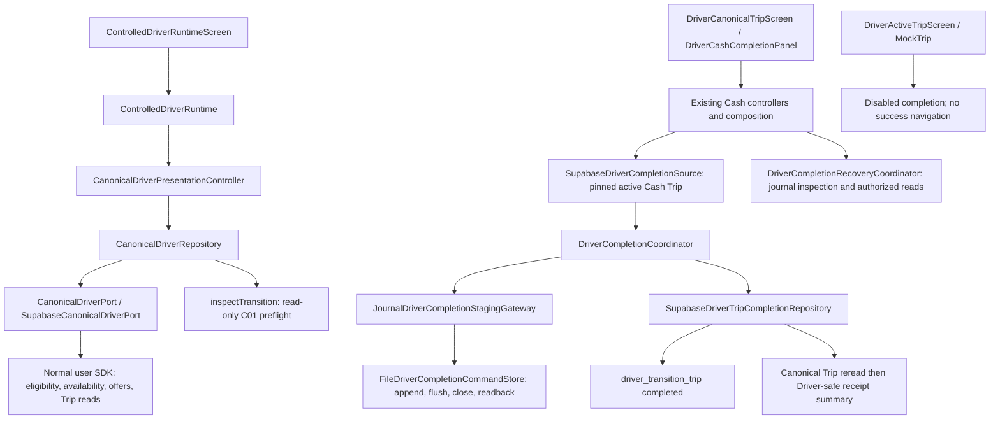

# P8-C01 - Driver lifecycle and authority audit

Owner: Moath / Developer 3. Issue #153. Local review checkpoint only.
Base: origin/main 3be1aa6. Assignment read from
origin/docs/phase-8-parallel-assignments-20261118, `Phase 8/Moath.md`.
Branch: feature/p8-c01-driver-completion-flow. C02 is not started.

## Current source path

These are existing separate runtime paths, not new wiring. C01 does not activate
or connect them. Completion coordinator and journal remain their original owners.

## Actual canonical transitions

`DriverTripLifecycleStatus` uses exact camelCase backend enum values.
`008_phase3_trip_cash_change_foundation.sql`'s `private.enforce_trip_transition`
is the edge authority, intersected with `014_phase3_driver_lifecycle_reconciliation.sql`'s
Driver RPC allowlist:

| Current | Forward Driver action | Driver cancellation |
|---|---|---|
| accepted | driverArriving | cancelledByDriver |
| driverArriving | driverArrived | cancelledByDriver |
| driverArrived | inProgress | cancelledByDriver |
| inProgress | completed | forbidden |
| completed or any other terminal | none | forbidden |

No skipped steps, reversal or terminal resurrection is a new valid command.
Same-status RPC acknowledgement can precede version comparison; it is not a new
transition or proof of permission to replay. Canonical reads can legitimately
skip intermediate observations when delivery is delayed.

Acceptance targets the offer ID/version and creates the Trip. Every subsequent
transition targets the exact Trip ID/version. P7 A04 wraps acceptance with matching
locks, expiry and active-Trip checks, and delegates non-acceptance to the preserved
017 wrapper. 017 locks the owned Trip, ensures server payment prerequisites,
checks Card progression for intermediate steps and delegates to the private
014 implementation (moved by 016). 014 requires approved unblocked Driver,
claims the actor/scope/key payload, checks Trip ownership/version and invokes
the transition trigger. Completion rejects an unapplied approved adjustment and
cancels unresolved changes; terminal completion clears active availability.
Cash settlement/receipt are server consequences in 017, never Flutter writes.
The 008 vehicle/driver FK and immutable assignment protect Trip vehicle identity;
acceptance verifies active compatible owned vehicle. Later RPCs do not independently
repeat availability/vehicle eligibility checks. Client preflight is stricter and
cannot replace server authorization or atomicity.

## Existing versus C01 changes

Existing: authenticated Cash-only canonical readers; revoked SDK session/epoch
ownership; canonical reference UI with blocked completion; completion command
triple and one-shot coordinator; journal-before-dispatch; UNKNOWN evidence;
authorized read-only recovery; canonical completion distinct from payment/receipt.
No replacement controller, completion repository or journal was introduced.

Added: Driver-only transition policy and `CanonicalDriverRepository.inspectTransition`.
It reuses existing eligibility and canonical parsing, requires exact Trip/version,
correlates onTrip availability and assigned vehicle before/after the Trip read,
checks unchanged availability version, then rechecks eligibility. It has no write,
key generation, staging, router or provider hook. Observed is a point-in-time
read result, never a reusable dispatch lease. C02 must revalidate at dispatch.

Legacy DriverActiveTripScreen previously called MockTrip completion and navigated
to shared success presentation. It now shows disabled completion and explicit
unverified payment/receipt text. Legacy controller behavior remains intact for
other consumers. Canonical and preview completion stop gates stay disabled.

Added a test-only fake Trip/transition port with an independent edge table,
version checks and original-key conflict/no-duplicate behavior. It simulates no
payment settlement or receipt and is never production authority.

## Verification

- Focused lifecycle audit + legacy completion hook: 51 passed initially.
- Driver journey regression updated for the explicit completion stop: 1 passed.
- Scoped `dart analyze` on all seven changed Dart files: no issues.
- `flutter analyze --no-pub`: 21 inherited diagnostics in unchanged files
  (3 unused-import warnings, 18 infos); exit 1. No new owned-file diagnostics.
- Final `flutter test --no-pub`: 2869 passed, 6 intentional skips, 0 failed.
  Existing completion/coordinator/journal/recovery suites are included. Initial
  full run caught one obsolete mock-success widget expectation; updated it and
  reran the full suite successfully.
- Host SDK: Flutter 3.41.2 / Dart 3.11.0, also the existing CI version.
  The guide's 3.27.3/3.6.1 is stale: the parent lockfile requires Dart >=3.8.
  Tests use temporary SDK-resolved dependencies, not exact committed-lockfile
  resolution. `flutter pub get --offline --enforce-lockfile` fails on this SDK:
  characters 1.4.0 -> 1.4.1, matcher 0.12.17 -> 0.12.18,
  material_color_utilities 0.11.1 -> 0.13.0, meta 1.16.0 -> 1.17.0,
  test_api 0.7.6 -> 0.7.9. Existing CI explicitly permits ephemeral `pub get`.
  Both parent and C01 lockfile blob: bb6148d20da9613013f01aa25dfefe82566360f1.
  No lockfile, dependency manifest, platform metadata or generated changes are
  committed. Exact-lockfile/older-toolchain acceptance remains unverified.
- No hosted configuration, hosted mutation, Stripe, migration, PR, push or merge.

## Remaining boundaries and exact handoff

Omar integration request (shared files, not changed here): gate
`/driver/completed` in `lib/app/router/app_router.dart` and the Driver branch of
`lib/features/trips/presentation/screens/trip_completion_screen.dart`. Direct URL,
deep link, restored route and in-app navigation must not render trusted success
from role alone, route parameters or any MockTrip, including a completed mock.
Require the reviewed existing completion/recovery owner to supply current,
session-bound canonical evidence for the exact Trip assigned to this Driver,
with completed status and canonical version. Without it, show unavailable or
recovery-required presentation. Remove hard-coded Driver fare JOD 1.99 and keep
payment/receipt claims unverified unless their own authorized evidence exists.
C01 removes mock success navigation from the Driver-owned active screen; it does
not fix this inherited direct-navigation presentation gap in shared ownership.

C02 must attach reviewed nonproduction completion interaction to existing
coordinator/journal, revalidate active Trip/vehicle eligibility at dispatch, and
verify canonical reread before success. Preflight alone cannot prevent a server
change immediately after a read. Active-Trip restoration and terminal presentation
remain C04. No new payment/receipt contract is claimed; Yousuf owns it. C03 retains
existing durable recovery/no-replay behavior and adds only proven missing cases.
File flush is not universal directory-fsync/power-loss acceptance. Hosted migration
discrepancy #149, live device authority and trusted hosted completion remain unproven.

C01 status: implemented locally; awaiting checkpoint review. Stop before C02.

## Independent review follow-up

A fresh reviewer inspected commit 2c52bc35708dd719168db051107113c7a9e87916,
its actual diff, backend wrappers/trigger, repository/presentation paths and tests.
No critical/high findings. One medium test-fake finding was corrected: original-key
replay returned before checking current authority. The fake now checks valid
session, role, block/approval and owned Trip before acknowledging a replay.
Seven focused negative cases cover logout, role, block, approval, assigned Driver,
actor and Trip ID changes. Six initially added cases were run against the original
fake and failed, confirming the regression; all seven pass after correction.

Review verification: 321 focused tests passed (lifecycle, legacy screen/journey,
canonical repository, coordinator, memory/file journal, read-only recovery).
All seven C01 Dart files pass scoped analysis. Full analysis reproduces the
same 21 diagnostics, in ten source files whose blobs are identical to the C01
parent. No production runtime or shared ownership changes were needed.

Review verdict: APPROVED for the bounded local C01 checkpoint after this fix;
owner approval is still required before C02. This does not approve hosted
completion or the shared success screen. Exact-lockfile limitation above is
inherited and explicitly qualified.
